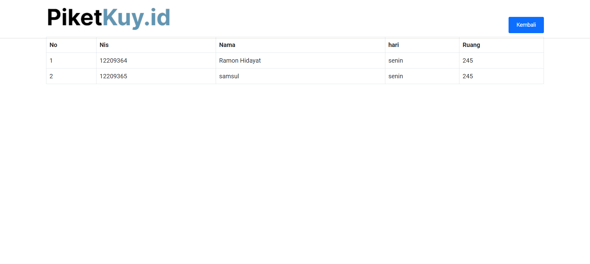

# Piketkuy

A web app for viewing a weekly class duty (*piket*) roster. Built with Laravel as a school project at SMK Wikrama Bogor.

## Screenshots

### Login page


### Home page


### Duty schedule page



## Features

- Login with role-based access (`admin` and `user`), enforced by a custom `cekRole` middleware
- Home page listing the school days, seeded from `HariSeeder`
- Per-day duty table showing the students assigned to that day (`/tabel/{day}`)
- Separate dashboard for admins

## Tech stack

- PHP 8, Laravel 9
- MySQL
- Blade templates, Vite

## Getting started

Requirements: PHP 8.0.2+, Composer, MySQL.

```bash
git clone https://github.com/Hidayatmramon/piketkuy.git
cd piketkuy
composer install
cp .env.example .env
php artisan key:generate
```

Create an empty database, then set `DB_DATABASE`, `DB_USERNAME`, and `DB_PASSWORD` in `.env`.

```bash
php artisan migrate --seed
php artisan serve
```

The seeders create sample accounts, including one admin. Their credentials are defined in `database/seeders/UserSeeder.php`. They are meant for local development only.

## Roadmap

- Admin screens to assign students to duty days (currently seeded)
- Use `POST` for logout instead of `GET`
- Add more request validation

## Status

Learning project, not actively developed.
